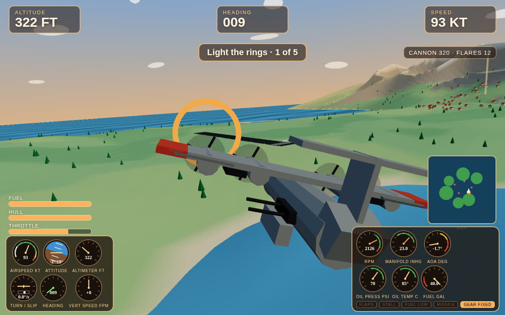
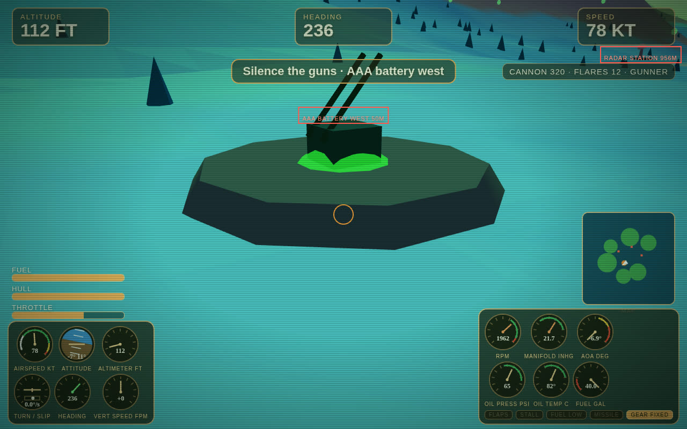

# Lentera Langit

Entry for the [Make the best flight game](https://make.fun/bounty/best-flight-game-20261126-0057) bounty on make.fun.

A Hercules gunship flies a dawn sortie over a New Zealand style archipelago.
Light the sky lanterns through five rings.
Destroy the radar station, the AAA batteries, and the supply depot with side cannons.
Drop supplies on the village.
Land before the fuel runs dry.

## Screenshots

| Cockpit final | Gunner mode | Sortie debrief |
| --- | --- | --- |
|  |  |  |

## Controls

| Key | Action |
| --- | --- |
| Click | Fly. Captures the mouse and fires the cannons |
| Mouse | Spring stick for pitch and roll. Esc releases it |
| W / S | Throttle up and down. S brakes on the ground |
| Arrow keys or A / D | Steer pitch and roll |
| Q / E | Yaw |
| G | Fire the side cannons |
| X | Deploy a flare decoy |
| T | Gunner mode with autopilot circuit |
| V | Chase and cockpit cameras |
| F | Flaps |
| Space | Drop the supply crate |
| R | Restart the sortie |

## Flight model

- Throttle, pitch, roll, and yaw. The stick springs toward a throttle trim, so the nose holds its climb.
- A banked turn bleeds speed and raises the stall. Stall drops the nose, buffets the wings, and lights the lamp.
- Ground effect softens the last metres of a descent. Fuel burn rises with throttle. A hard touchdown takes hull.
- Flaps lower the stall speed. Chop the throttle and brake to roll the landing out.

## Combat

- Four turboprops, side cannons on both flanks, and flare pods under the wings.
- Ground targets: a radar station, two AAA batteries, a supply depot, and a truck convoy.
- AAA batteries throw flak when you are close and launch homing missiles from farther out.
- A piper marks where the cannons will strike. Misses kick up dust. Kills leave a smoke column.
- A flare decoy pulls a missile off the aircraft.
- Gunner mode hands the flying to an autopilot circuit while the player aims with the mouse.

## Instruments

- Basic-T six pack: airspeed, attitude, altimeter, turn and slip, heading, vertical speed.
- Engine cluster: RPM, manifold pressure, angle of attack, oil pressure, oil temperature, fuel gallons.
- Every gauge prints its live numeric value.
- Warning lamps cover flaps, stall, low fuel, and inbound missiles.

## Sortie

1. Fly through five orange rings. Each ring you light sends lanterns up.
2. Destroy the four installations.
3. Drop the crate on the village marker.
4. Land on the runway or on the water beside the boat.
5. Score grades the sortie S, A, B, or C.

## Build

Three.js renders the world from static files.
One height function builds the terrain mesh and answers collision queries.
Web Audio synthesises the engines, the wind, the cannons, and the theme motif.
No network request leaves the game folder.
Run `node serve.ts` from the kit layout or open `game/index.html` through any static server.

## License

MIT. See [LICENSE](LICENSE).
