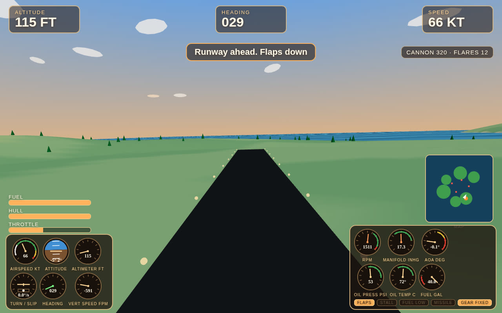
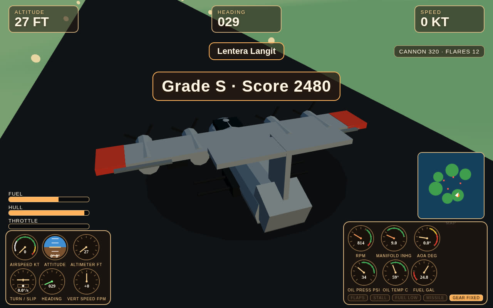

# Lentera Langit

Entry for the [Make the best flight game](https://make.fun/bounty/best-flight-game-20261126-0057) bounty on make.fun.

A ground raid across the same archipelago. You insert on the airstrip and fight on foot
to the village: phase lines, garrisoned compounds, then an extract back to the strip.
The Three.js island, height field, and module loop are the original gunship sortie,
retuned for a modern infantry firefight.

## Screenshots

The images below are the earlier gunship pass. The playable build is the ground raid.

| Earlier cockpit | Earlier gunner | Earlier debrief |
| --- | --- | --- |
|  |  |  |

## Controls

| Key | Action |
| --- | --- |
| Click | Capture the mouse |
| W A S D | Move |
| Mouse | Look |
| Shift | Sprint. Drains stamina |
| Ctrl / C | Crouch |
| Z | Prone |
| Q / E | Lean |
| Space | Jump |
| Left mouse | Fire |
| Right mouse | Aim down sights |
| R | Reload. Restarts after a death or a finished raid |
| T | Auto and semi |
| 1 / 2 | Carbine and sidearm |
| G | Frag |
| X | Smoke. Breaks a rocket lock |
| F | Steady aim while sighted and still |
| V | First person and shoulder camera |
| Enter | Restart the raid |

## Movement

- Walk, sprint, crouch, prone, jump, and lean on the island height field.
- Sprint is faster than a real soldier so the existing island stays the battlefield.
- Hills block shots. Smoke and crouch make return fire less accurate.
- Health regenerates after a few seconds out of the fight. Armor does not.

## Combat

- M4A1 carbine, 30-round magazine, auto or semi, with recoil and spread.
- M19 sidearm when the carbine runs dry.
- Two frags and two smokes.
- Four compounds along the airstrip-to-village road. Each falls when its garrison does.
- Gun pits fire rockets. A smoke cloud pulls the rocket off you.

## Raid

1. Walk the five phase lines.
2. Clear the compounds.
3. Hold on the village cache.
4. Extract on the airstrip.
5. Score grades the raid S, A, B, or C.

## Build

Three.js renders the world from static files.
One height function builds the terrain mesh and answers collision queries.
Web Audio synthesises the gunshots, the wind, the footsteps, and the objective stingers.
No network request leaves the game folder.
Run `node serve.ts` from the kit layout or open `game/index.html` through any static server.

## License

MIT. See [LICENSE](LICENSE).
